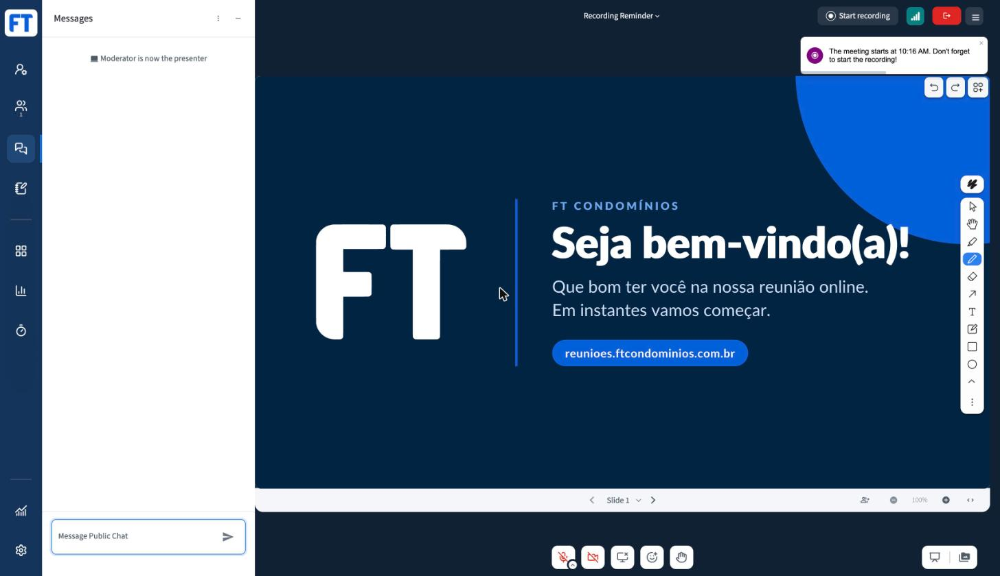
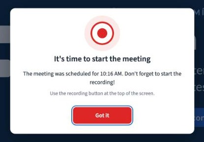
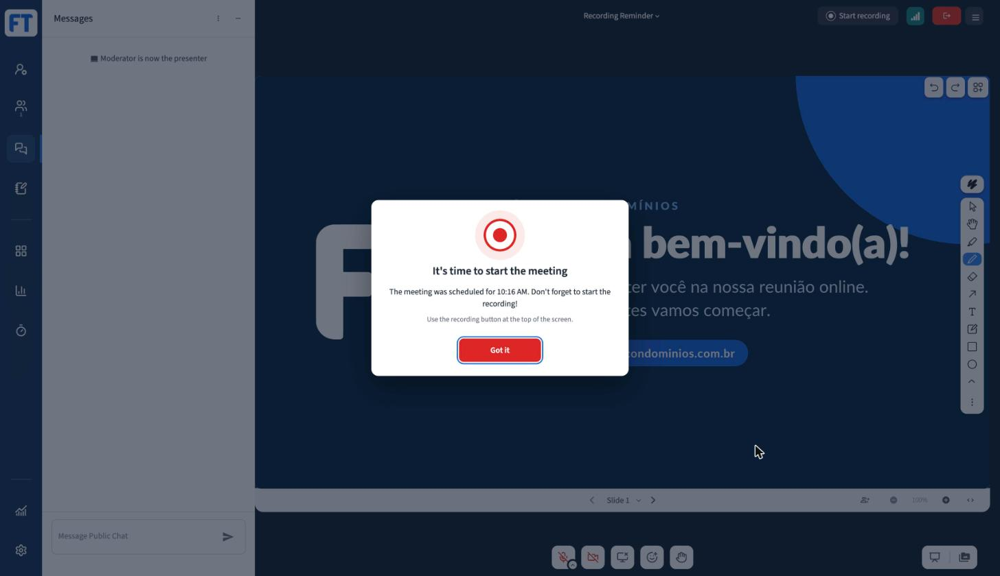
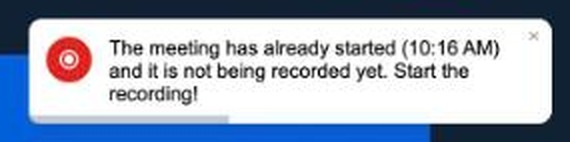
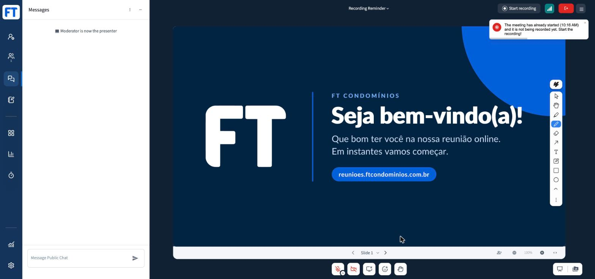

# Recording Reminder

A [BigBlueButton](https://bigbluebutton.org) plugin that keeps reminding moderators to start the recording until they do.

You can pass the scheduled start time of the meeting in the `/create` call. The plugin then:

1. **Before the scheduled start** (or when no start time is given) shows a small reminder every few minutes.
2. **At the scheduled start** shows a blocking alert that must be dismissed with a click.
3. **After the scheduled start** keeps showing reminders every few minutes.

Once a recording has been started in the meeting, the plugin stops for good, even if the recording is paused later.

## Screenshots

### 1. Before the scheduled start

A warning toast, repeated every `reminderInterval` minutes (it reads *"Don't forget to start the recording!"* when no start time was given).


<details>
<summary>Full screen</summary>



</details>

### 2. At the scheduled start

A blocking alert over the whole client, shown once, that only closes when the moderator clicks **Got it**.



<details>
<summary>Full screen</summary>



</details>

### 3. After the scheduled start

An error toast, repeated every `lateReminderInterval` minutes until the recording starts.



<details>
<summary>Full screen</summary>



</details>

## How it works

- Only **moderators** are reminded.
- It only runs in meetings where moderators can start the recording themselves: `record=true`, `allowStartStopRecording=true` and no `autoStartRecording`.
- The recording state comes from the server (`meeting_recording`). This means the plugin also stays quiet after a page reload, and for moderators who join after the recording was started.
- If the recording starts while the alert is open, the alert closes by itself.
- The first reminder shows about 20 seconds after joining.
- If a moderator joins after the scheduled start, they see the alert right away.

## Parameters

All parameters are optional and go in the `/create` API call:

| Parameter | Default | Description |
|---|---|---|
| `plugin_RecordingReminder_startTime` | *(none)* | Scheduled start of the meeting. Without it there is no alert, only the periodic reminder. |
| `plugin_RecordingReminder_reminderInterval` | `5` | Minutes between reminders **before** the scheduled start. |
| `plugin_RecordingReminder_lateReminderInterval` | `2` | Minutes between reminders **after** the scheduled start. |

Accepted formats for `startTime`:

| Format | Example | Notes |
|---|---|---|
| ISO 8601 | `2026-10-26T14:00:00-03:00` | Without an offset the time is read in the browser's time zone |
| Unix timestamp | `1793034000` or `1793034000000` | Seconds or milliseconds |
| `HH:mm` | `14:00` | Today, in the browser's time zone |

URL-encode the value, as with any API parameter. An offset like `+01:00` must be sent as `%2B01:00` (a `+` decoded as a space is also accepted).

Example:

```
create?meetingID=my-meeting&name=My%20Meeting&record=true
      &plugin_RecordingReminder_startTime=2026-10-26T14%3A00%3A00-03%3A00
      &plugin_RecordingReminder_reminderInterval=5
      &plugin_RecordingReminder_lateReminderInterval=2
      &checksum=...
```

### How the parameters reach the plugin

bbb-web replaces `${plugin_<PluginName>_<param>:<default>}` placeholders in the plugin's `manifest.json` with the values passed in `/create`. The manifest puts them in the query string of `javascriptEntrypointUrl`:

```json
"javascriptEntrypointUrl": "RecordingReminder.js?startTime=${plugin_RecordingReminder_startTime:}&reminderInterval=${plugin_RecordingReminder_reminderInterval:}&lateReminderInterval=${plugin_RecordingReminder_lateReminderInterval:}"
```

The plugin reads them from its own `<script>` URL when it loads. Every placeholder has an empty default, so meetings created without these parameters still load the plugin.

## Internationalization

Texts follow the user's client language. The plugin uses the same pattern as [bbb-plugin-pick-random-user](https://github.com/bigbluebutton/bbb-plugin-pick-random-user): `pluginApi.useLocaleMessages` and `react-intl`, with the locale files in `public/locales/`.

Available languages:

| File | Language |
|---|---|
| `de.json` | German |
| `en.json` | English |
| `fr-FR.json` | French |
| `it.json` | Italian |
| `ja.json` | Japanese |
| `pt-BR.json` | Portuguese (Brazil) |

To add a language, create `public/locales/<locale>.json` with the same keys as `en.json` and add it to `public/locales/index.json`.

## Compatibility

| Plugin | BigBlueButton | SDK |
|---|---|---|
| 0.2.x | 4.0 | `bigbluebutton-html-plugin-sdk` 1.0.0-beta.3 |

## Building

Requires Node.js 22+.

```bash
npm install
npm run build-bundle
```

This writes `dist/` with `RecordingReminder.js`, `manifest.json` and `locales/`.

For development, `npm start` serves the plugin and its manifest at `http://localhost:4701/manifest.json`.

## Installing on a BigBlueButton server

1. Copy the contents of `dist/` to the server:

   ```bash
   sudo mkdir -p /var/www/bigbluebutton-default/assets/plugins/bbb-plugin-recording-reminder
   sudo cp -r dist/* /var/www/bigbluebutton-default/assets/plugins/bbb-plugin-recording-reminder/
   ```

   This makes it available at `https://<your-server>/plugins/bbb-plugin-recording-reminder/manifest.json`.

2. Add the manifest to `pluginManifests` in `/etc/bigbluebutton/bbb-web.properties`:

   ```properties
   pluginManifests=[{"url":"https://<your-server>/plugins/bbb-plugin-recording-reminder/manifest.json"}]
   ```

   Keep any existing entries in the list.

3. Restart bbb-web:

   ```bash
   sudo systemctl restart bbb-web
   ```

You can also load it for a single meeting with the `pluginManifests` parameter of `/create`.
